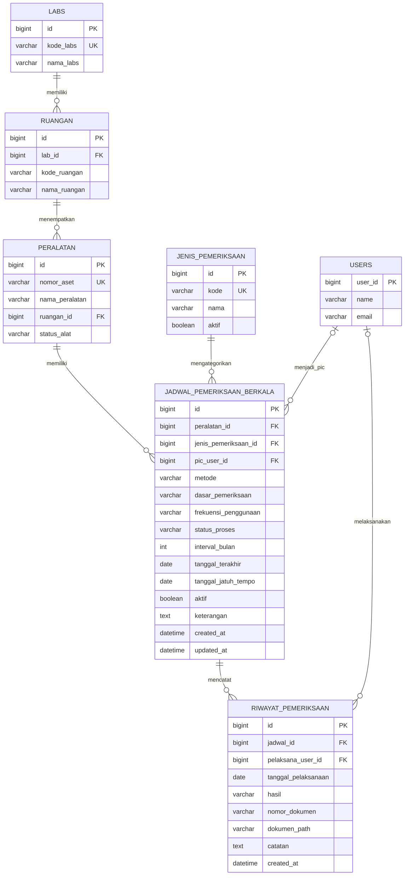
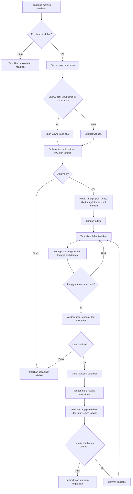

# ERD Penjadwalan Pemeriksaan Peralatan SiKEPo

Dokumen ini mengusulkan struktur database untuk fitur jadwal kalibrasi,
verifikasi fungsi, pengecekan antara, dan pemeliharaan. Jenis tindakan
disatukan dalam satu tabel jadwal; satu baris jadwal mewakili satu jenis
tindakan pada satu peralatan. Setiap pelaksanaan disimpan sebagai riwayat
tersendiri.

> Diagram ini adalah rancangan target, bukan gambaran bahwa semua tabel dan
> relasi sudah diterapkan di database saat ini. `jadwal_pemeriksaan_berkala`
> sudah ada di backend, tetapi model/endpoint yang ada masih perlu disesuaikan
> agar mendukung banyak jadwal peralatan dan histori pelaksanaan.

## ERD

### Kardinalitas dan aturan data

- Satu **lab** memiliki banyak ruangan; satu ruangan berada di satu lab.
- Satu **ruangan** menampung banyak peralatan; satu peralatan berada di satu
  ruangan sesuai struktur SiKEPo saat ini.
- Satu **peralatan** dapat memiliki banyak jadwal. Contohnya, satu alat dapat
  memiliki jadwal kalibrasi dan pengecekan antara sekaligus.
- Satu **jenis pemeriksaan** dapat digunakan oleh banyak jadwal.
- Satu **jadwal** dapat memiliki banyak riwayat pelaksanaan. Riwayat lama tidak
  ditimpa ketika pemeriksaan berikutnya dicatat.
- PIC pada jadwal dan pelaksana pada riwayat merujuk ke `users.user_id`.
  Keduanya boleh kosong jika penugasan/pelaksana belum ditentukan.
- Kombinasi peralatan dan jenis pemeriksaan sebaiknya hanya memiliki satu
  jadwal aktif. Tegakkan aturan ini dengan validasi backend atau constraint
  database yang sesuai dengan strategi pengarsipan jadwal.
- `interval_bulan`, `tanggal_terakhir`, dan `tanggal_jatuh_tempo` boleh kosong
  saat jadwal belum dikonfigurasi. Kondisi ini ditampilkan sebagai
  **Belum Diatur**, bukan sebagai tanggal atau interval buatan.
- Status urgensi seperti **Terlambat**, **Mendesak**, **Mendekati Jatuh Tempo**,
  dan **Aman** dihitung ketika data dibaca dari tanggal jatuh tempo dan ambang
  hari yang disepakati. Status urgensi tidak disimpan sebagai nilai tetap.
- Status proses jadwal, misalnya `terjadwal`, `dalam_proses`, atau `dijeda`,
  disimpan pada jadwal karena mencerminkan keadaan proses, bukan hitungan waktu.
- Status kondisi/penggunaan alat, seperti **Dipinjam**, **Rusak**, atau
  **Karantina**, tetap merupakan status peralatan, bukan status jadwal.
  Tampilan dapat menggabungkan status proses jadwal dengan urgensi dan status
  alat tanpa menyatukan ketiganya menjadi satu nilai status.

### Indeks yang disarankan

- `jadwal_pemeriksaan_berkala(peralatan_id, jenis_pemeriksaan_id)` untuk
  pencarian jadwal alat dan pemeriksaan duplikat.
- `jadwal_pemeriksaan_berkala(aktif, tanggal_jatuh_tempo)` untuk daftar tindakan
  dan pengurutan berdasarkan jatuh tempo.
- `jadwal_pemeriksaan_berkala(pic_user_id, aktif)` untuk daftar tugas PIC.
- `riwayat_pemeriksaan(jadwal_id, tanggal_pelaksanaan)` untuk riwayat per
  jadwal.

## Alur data penjadwalan dan pencatatan hasil

## Makna data yang ditampilkan pada daftar tindakan

| Data pada layar | Sumber yang disarankan |
|---|---|
| Nomor aset, nama alat, lab | `peralatan` → `ruangan` → `labs` |
| Jenis dan metode pemeriksaan | `jadwal_pemeriksaan_berkala` → `jenis_pemeriksaan` |
| Tanggal terakhir dan hasil terakhir | Jadwal untuk tanggal ringkas; riwayat terbaru untuk hasil |
| Jatuh tempo dan sisa hari | `tanggal_jatuh_tempo`, dihitung relatif ke tanggal saat ini |
| Status urgensi | Hasil perhitungan backend dari jatuh tempo dan ambang hari |
| Status alat | `peralatan.status_alat` |
| PIC | `jadwal_pemeriksaan_berkala.pic_user_id` → `users` |
| Sertifikat/laporan dan catatan historis | `riwayat_pemeriksaan` |

## Hubungan dengan model backend saat ini

Model [JadwalPemeriksaanBerkala](../models/jadwal_pemeriksaan_berkala.go)
saat ini sudah memuat jenis jadwal, interval, tanggal, dan beberapa detail
metode/dokumen. Untuk mengikuti rancangan ini:

1. Pertahankan satu tabel jadwal, tetapi gunakan identitas jenis pemeriksaan
   yang konsisten. `jenis_pemeriksaan_id` pada diagram adalah usulan lookup
   table; alternatif yang lebih sederhana adalah kolom kode terkontrol
   `jenis_jadwal` pada tabel jadwal.
2. Ubah PIC dari teks bebas menjadi foreign key ke `users.user_id`.
3. Jangan menolak jadwal kedua hanya karena alat yang sama sudah memiliki
   jadwal; validasi duplikasi berdasarkan peralatan dan jenis pemeriksaan.
4. Tambahkan tabel riwayat pelaksanaan. `tanggal_realisasi` saja tidak cukup
   untuk menyimpan hasil dan beberapa kali pelaksanaan tanpa menimpa data.
5. Catat hasil dan perbarui ringkasan jadwal dalam satu transaksi agar tanggal
   jatuh tempo tidak berubah tanpa riwayat yang berhasil tersimpan.
6. Sebelum migrasi, verifikasi tipe ID dan constraint pada database aktual;
   konfigurasi migrasi backend saat ini menonaktifkan pembuatan foreign key
   otomatis oleh GORM.
